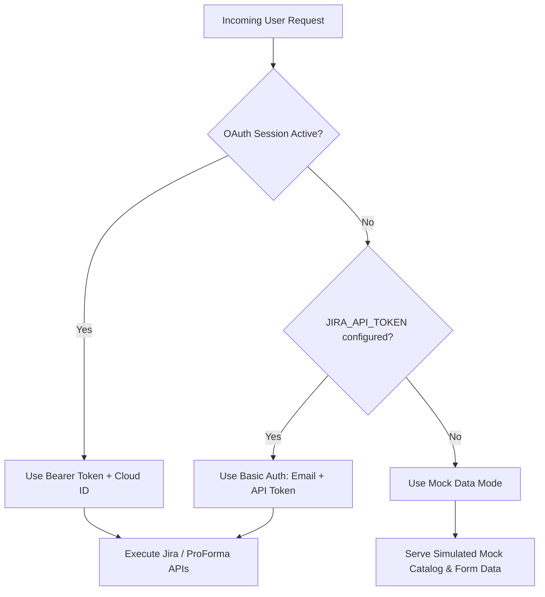

# JSM Customer Portal Frontend

A modern, full-featured Customer Portal for **Jira Service Management (JSM)** built with **Next.js 16 (App Router)**, **TypeScript**, **Tailwind CSS**, and **Atlassian REST APIs**.

Supports Atlassian OAuth 2.0 (3LO), API Token authentication, full ProForma (Jira Forms) attached form rendering, comprehensive JSM field formats, real-time ticket tracking, and an offline mock mode for testing and local development.

---

## Table of Contents

1. [Architecture & Authentication Flow](#architecture--authentication-flow)
2. [Complete API Reference](#complete-api-reference)
   - [Internal Next.js Route Handlers (`/api/jsm/*`)](#1-internal-nextjs-route-handlers-apijsm)
   - [External Atlassian JSM REST APIs](#2-external-atlassian-jsm-rest-apis)
   - [External Jira Platform REST APIs (v3)](#3-external-jira-platform-rest-apis-v3)
   - [External Atlassian Forms (ProForma) Cloud APIs](#4-external-atlassian-forms-proforma-cloud-apis)
3. [Supported JSM Field Types Matrix](#supported-jsm-field-types-matrix)
4. [Environment Configuration](#environment-configuration)
5. [Getting Started](#getting-started)

---

## Architecture & Authentication Flow

The application dynamically chooses authentication strategies in the following priority order via `getJiraAuthContext()`:



---

## Complete API Reference

### 1. Internal Next.js Route Handlers (`/api/jsm/*`)

These endpoints are exposed by the Next.js backend and consumed by client-side portal components.

| Endpoint | Method | Description | Primary Query / Body Parameters |
| :--- | :--- | :--- | :--- |
| [`/api/jsm/portal`](file:///k:/Web%20Projects/jsm-portal-frontend/app/api/jsm/portal/route.ts) | `GET` | Returns service desk portal metadata (name, project, description, auth status). | None |
| [`/api/jsm/request-types`](file:///k:/Web%20Projects/jsm-portal-frontend/app/api/jsm/request-types/route.ts) | `GET` | Fetches grouped request types and categories for the portal catalog. | None |
| [`/api/jsm/fields/[id]`](file:///k:/Web%20Projects/jsm-portal-frontend/app/api/jsm/fields/[id]/route.ts) | `GET` | Resolves standard Jira fields and merges any attached ProForma forms for a given request type. | Route param `id`: Request Type ID |
| [`/api/jsm/directory`](file:///k:/Web%20Projects/jsm-portal-frontend/app/api/jsm/directory/route.ts) | `GET` | Typeahead search for Single/Multi User Pickers and Group Pickers. | `type`: `user` \| `group`<br>`query`: string |
| [`/api/jsm/submit`](file:///k:/Web%20Projects/jsm-portal-frontend/app/api/jsm/submit/route.ts) | `POST` | Validates and creates a JSM ticket + submits ProForma answers and attachments. | `{ requestTypeId, fieldValues, fields, userEmail }` |
| [`/api/jsm/tickets`](file:///k:/Web%20Projects/jsm-portal-frontend/app/api/jsm/tickets/route.ts) | `GET` | Retrieves customer tickets filtered by reporter email or project JQL. | `email` (optional) |
| [`/api/jsm/tickets/[id]`](file:///k:/Web%20Projects/jsm-portal-frontend/app/api/jsm/tickets/[id]/route.ts) | `GET` | Retrieves full ticket details, status timeline, custom fields, and public comments. | Route param `id`: Issue Key (e.g. `ITSD-101`) |
| [`/api/jsm/tickets/[id]/comment`](file:///k:/Web%20Projects/jsm-portal-frontend/app/api/jsm/tickets/[id]/comment/route.ts) | `POST` | Adds a public customer comment or reply to an existing ticket. | `{ body: string }` |
| [`/api/auth/[...nextauth]`](file:///k:/Web%20Projects/jsm-portal-frontend/app/api/auth/[...nextauth]/route.ts) | `GET`, `POST` | NextAuth.js OAuth 2.0 3LO handler for Atlassian authentication. | Handled by NextAuth |

---

### 2. External Atlassian JSM REST APIs

Used for Service Desk management, customer requests, field schemes, and ticket interactions.

| Endpoint | Method | Purpose in Portal | Upstream Docs |
| :--- | :--- | :--- | :--- |
| `/rest/servicedeskapi/servicedesk/{serviceDeskId}` | `GET` | Fetches project info and underlying `projectId`. | [JSM REST Docs](https://developer.atlassian.com/cloud/jira/service-desk/rest/intro/#about) |
| `/rest/servicedeskapi/servicedesk/{serviceDeskId}/requesttypegroup` | `GET` | Retrieves request type group categories. | [Get Request Type Groups](https://developer.atlassian.com/cloud/jira/service-desk/rest/api-group-servicedesk/#api-rest-servicedeskapi-servicedesk-servicedeskid-requesttypegroup-get) |
| `/rest/servicedeskapi/servicedesk/{serviceDeskId}/requesttype` | `GET` | Fetches all active request types for the service desk. | [Get Request Types](https://developer.atlassian.com/cloud/jira/service-desk/rest/api-group-servicedesk/#api-rest-servicedeskapi-servicedesk-servicedeskid-requesttype-get) |
| `/rest/servicedeskapi/servicedesk/{serviceDeskId}/requesttype/{requestTypeId}/field` | `GET` | Fetches standard visible request type fields and validation schemas. | [Get Request Type Fields](https://developer.atlassian.com/cloud/jira/service-desk/rest/api-group-servicedesk/#api-rest-servicedeskapi-servicedesk-servicedeskid-requesttype-requesttypeid-field-get) |
| `/rest/servicedeskapi/servicedesk/{serviceDeskId}/user?query={query}` | `GET` | Customer directory fallback search. | [Get Customers](https://developer.atlassian.com/cloud/jira/service-desk/rest/api-group-servicedesk/#api-rest-servicedeskapi-servicedesk-servicedeskid-user-get) |
| `/rest/servicedeskapi/request` | `POST` | Creates the customer ticket with `requestFieldValues` and optional `raiseOnBehalfOf`. | [Create Customer Request](https://developer.atlassian.com/cloud/jira/service-desk/rest/api-group-request/#api-rest-servicedeskapi-request-post) |
| `/rest/servicedeskapi/request/{issueIdOrKey}` | `GET` | Fetches ticket summary, SLA, current status, and reporter info. | [Get Customer Request](https://developer.atlassian.com/cloud/jira/service-desk/rest/api-group-request/#api-rest-servicedeskapi-request-issueidorkey-get) |
| `/rest/servicedeskapi/request/{issueIdOrKey}/status` | `GET` | Fetches customer-facing status transition history. | [Get Status History](https://developer.atlassian.com/cloud/jira/service-desk/rest/api-group-request/#api-rest-servicedeskapi-request-issueidorkey-status-get) |
| `/rest/servicedeskapi/request/{issueIdOrKey}/comment` | `GET` | Retrieves public customer comments. | [Get Request Comments](https://developer.atlassian.com/cloud/jira/service-desk/rest/api-group-request/#api-rest-servicedeskapi-request-issueidorkey-comment-get) |
| `/rest/servicedeskapi/request/{issueIdOrKey}/comment` | `POST` | Posts a public comment to the request (`{ body, public: true }`). | [Create Request Comment](https://developer.atlassian.com/cloud/jira/service-desk/rest/api-group-request/#api-rest-servicedeskapi-request-issueidorkey-comment-post) |
| `/rest/servicedeskapi/info` | `GET` | Connectivity test and instance platform verification. | [Get Info](https://developer.atlassian.com/cloud/jira/service-desk/rest/api-group-info/#api-rest-servicedeskapi-info-get) |

---

### 3. External Jira Platform REST APIs (v3)

Used for user/group directory searches, JQL searches, and rich issue metadata.

| Endpoint | Method | Purpose in Portal |
| :--- | :--- | :--- |
| `/rest/api/3/user/picker?query={query}&showAvatar=true` | `GET` | Primary typeahead search for User Picker fields (returns avatar URLs, display names, `accountId`). |
| `/rest/api/3/user/search?query={query}` | `GET` | Fallback search for Jira users and assignees. |
| `/rest/api/3/group/picker?query={query}` | `GET` | Typeahead lookup for Jira IAM and Security Group picker fields. |
| `/rest/api/3/search/jql?jql={jql}` | `GET` | Jira Cloud v3 JQL ticket queries (e.g. `reporter = 'user@email.com' ORDER BY created DESC`). |
| `/rest/api/3/search?jql={jql}` | `GET` | Standard JQL query fallback endpoint. |
| `/rest/api/3/issue/{issueIdOrKey}` | `GET` | Detailed issue metadata resolution (status category, custom fields, components, attachments). |
| `/_edge/tenant_info` | `GET` | Resolves Jira Cloud ID (`cloudId`) when running in OAuth context. |

---

### 4. External Atlassian Forms (ProForma) Cloud APIs

Used for dynamic form rendering and submitting structured forms attached to request types.

| Endpoint | Method | Purpose in Portal |
| :--- | :--- | :--- |
| `https://api.atlassian.com/jira/forms/cloud/{cloudId}/project/{projectId}/form` | `GET` | Lists all ProForma forms configured in the project and identifies attached request types. |
| `https://api.atlassian.com/jira/forms/cloud/{cloudId}/project/{projectId}/form/{formId}` | `GET` | Fetches the full form design schema (questions, layouts, choices, conditional logic, types). |
| `https://api.atlassian.com/jira/forms/cloud/{cloudId}/issue/{issueIdOrKey}/form` | `POST` | Attaches a form template to a newly created ticket (`{ formTemplate: { id: formId } }`). |
| `https://api.atlassian.com/jira/forms/cloud/{cloudId}/issue/{issueIdOrKey}/form/{formId}/answers` | `PUT` | Submits structured question answers (`answers: { [qId]: { text, choices, users, date, time } }`). |

---

## Supported JSM Field Types Matrix

The portal supports **all standard Jira Service Management field formats** and **ProForma question types**:

| Field Format | JSM Schema Type / ProForma Code | Payload Structure (`requestFieldValues`) | ProForma Structure (`answers`) |
| :--- | :--- | :--- | :--- |
| **Single User Picker** | `user` / `us` | `{ accountId: "usr-1001" }` | `{ users: ["usr-1001"] }` |
| **Multi User Picker** | `array<user>` / `um` | `[{ accountId: "usr-1001" }, { accountId: "usr-1002" }]` | `{ users: ["usr-1001", "usr-1002"] }` |
| **Single Group Picker** | `group` / `gr` | `{ name: "engineering-team" }` | `{ groups: ["engineering-team"] }` |
| **Multi Group Picker** | `array<group>` / `gm` | `[{ name: "grp-1" }, { name: "grp-2" }]` | `{ groups: ["grp-1", "grp-2"] }` |
| **Cascading Select** | `cascadingselect` / `cs` | `{ id: "parent_id", child: { id: "child_id" } }` | `{ choices: ["parent_id", "child_id"] }` |
| **Single Choice / Dropdown** | `option` / `cd` | `{ id: "opt_101" }` | `{ choices: ["opt_101"] }` |
| **Radio Buttons** | `radiobuttons` / `cr` | `{ id: "opt_101" }` | `{ choices: ["opt_101"] }` |
| **Checkboxes / Multi-Select** | `array<option>` / `cm` | `[{ id: "opt_1" }, { id: "opt_2" }]` | `{ choices: ["opt_1", "opt_2"] }` |
| **Labels / Tags** | `array<string>` / `labels` | `["security", "cloud", "audit"]` | `{ choices: ["security", "cloud"] }` |
| **Date Picker** | `date` / `da`, `df` | `"2026-09-01"` | `{ date: "2026-09-01" }` |
| **DateTime Picker** | `datetime` / `dt` | `"2026-09-01T14:30:00.000Z"` | `{ text: "2026-09-01T14:30" }` |
| **Time Picker** | `time` / `ti` | `"14:30"` | `{ time: "14:30" }` |
| **Number** | `number` / `nu` | `42` | `{ number: 42, text: "42" }` |
| **Email** | `email` / `em` | `"user@enterprise.com"` | `{ text: "user@enterprise.com" }` |
| **URL** | `url` / `url` | `"https://status.company.com"` | `{ text: "https://..." }` |
| **Asset / Insight** | `asset` / `cmdb` | `[{ key: "AST-10021" }]` | `{ text: "AST-10021" }` |
| **Paragraph / Textarea** | `textarea` / `pa`, `tl` | `"Detailed multi-line explanation..."` | `{ text: "..." }` |
| **Text (Single Line)** | `string` / `te`, `ts` | `"Summary text"` | `{ text: "..." }` |
| **File Upload** | `attachment` / `at` | Uploaded via attachment pipeline | Attachment ID |
| **Info / Banner** | `info` / `in`, `message` | Client-side visual callout box | N/A |

---

## Knowledge Base Integration & Permissions

This portal supports rendering **Confluence Knowledge Base articles** natively (no iframes required) right inside the Next.js app. Because Atlassian maintains strict internal boundaries between Jira Service Management and Confluence, the portal utilizes a **Hybrid Dual-Auth Architecture**:

1. **User Auth (OAuth 2.0 / 3LO):** 
   - Used for all user-facing actions (searching the knowledge base, viewing tickets, creating requests).
   - Generates tokens using the user's logged-in identity.
2. **System Auth (API Token):**
   - Used **exclusively** by the Next.js backend as a secure "System Account" proxy to download the raw HTML body and images of Confluence articles.
   - Atlassian restricts retrieving raw Confluence page HTML via standard JSM OAuth scopes.

### Required Setup Steps for Knowledge Base

To make the native Knowledge Base article viewer work perfectly:

#### 1. Configure the "System Account" (API Token)
You must define an Atlassian account to act as the backend System Account.
- Ensure the account belonging to `JIRA_USER_EMAIL` has an active **Confluence Product License** in your Atlassian Admin settings. If it does not have a Confluence license, Atlassian will return `401 Access Denied` when the backend attempts to fetch the article HTML.
- Generate an Atlassian API Token for this account.
- Add them to your `.env.local`:
  ```env
  JIRA_USER_EMAIL=your_admin_email@example.com
  JIRA_API_TOKEN=your_generated_api_token
  ```
- **Note:** End-users (the people logging into the portal) **do not** need Confluence licenses. The backend proxy handles fetching the content on their behalf.

#### 2. Configure the OAuth Application Scopes (Developer Console)
In the **Atlassian Developer Console**, your OAuth 2.0 (3LO) app must have the following classic scopes enabled:
- **Jira API (Classic):**
  - `read:jira-work`
  - `read:jira-user`
  - `write:jira-work`
  - `read:servicedesk-request`
  - `write:servicedesk-request`
- **Jira API (Granular):**
  - `read:knowledgebase:jira-service-management` (Search and view knowledgebase articles)
- **Confluence API (Classic):**
  - `read:confluence-space.summary`
  - `read:confluence-content.summary`
- **User Identity API:**
  - `read:me`

After adding or modifying these scopes in the Atlassian Developer Console, **all users must sign out and sign back in** to generate a new token reflecting the updated consent permissions.

---

## Environment Configuration

Create a `.env.local` file in the root directory:

```env
# Atlassian Jira Cloud Configuration
JIRA_BASE_URL=https://your-domain.atlassian.net
JIRA_USER_EMAIL=service-account@company.com
JIRA_API_TOKEN=your_jira_api_token
JIRA_SERVICE_DESK_ID=1

# Optional: Atlassian Cloud ID for ProForma Forms API
ATLASSIAN_CLOUD_ID=your_atlassian_cloud_id

# Optional: Atlassian OAuth 2.0 (3LO) Credentials
ATLASSIAN_CLIENT_ID=your_oauth_client_id
ATLASSIAN_CLIENT_SECRET=your_oauth_client_secret
NEXTAUTH_SECRET=your_generated_nextauth_secret
NEXTAUTH_URL=http://localhost:3000
```

> **Note**: If `JIRA_API_TOKEN` and OAuth are omitted, the application automatically activates **Mock Mode**, allowing complete offline evaluation with realistic request types and forms.

---

## Getting Started

### Install Dependencies
```bash
npm install
```

### Start Development Server
```bash
npm run dev
```

Visit [http://localhost:3000](http://localhost:3000) to access the customer portal.

### Build Production Bundle
```bash
npm run build
npm start
```

